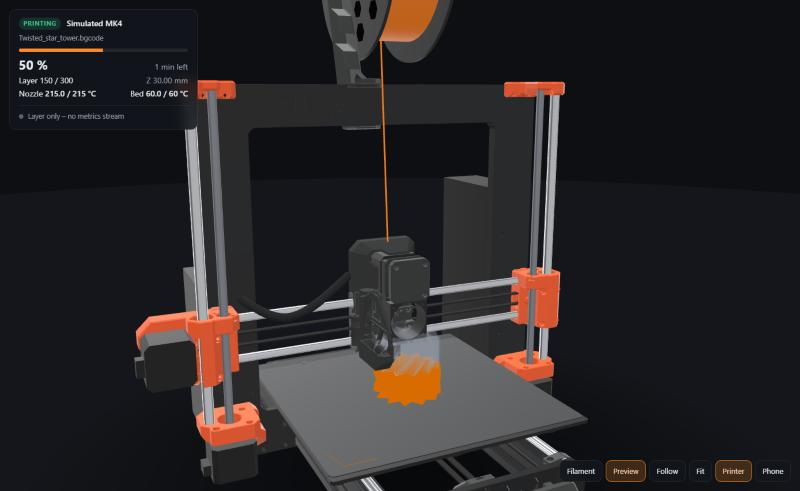

# PrintTwin – a live 3D digital twin of your 3D printer

**Watch your print grow in real time, in 3D.** PrintTwin follows your printer live and
draws the part in your browser exactly as the nozzle lays it down – on a true-to-size,
animated model of the printer whose bed, gantry and extruder move with the real machine.
A live G-code / bgcode viewer for Prusa printers via PrusaLink. Works on PC, tablet and phone.


| Close to the nozzle | Slicer feature colours + preview of what's still to print |
|---|---|
|  |  |

## Supported printers

PrintTwin started on the Original Prusa MK4 – **support for more printers is in the works**.

| Printer | Connection | Status |
|---|---|---|
| **Original Prusa MK4** | PrusaLink + firmware metrics | ✅ tested (firmware 8.0), true-to-size 3D model |
| **Original Prusa MK4S** | PrusaLink + firmware metrics | 🧪 should work today (same firmware) – **testers wanted**; true-to-size 3D model |
| Original Prusa MK3.9 / MK3.9S | PrusaLink + firmware metrics | 🧪 should work today – **testers wanted**; shown as the MK4 / MK4S (approximate) |
| Original Prusa MINI / MINI+ | PrusaLink + firmware metrics | 🧪 should work today – **testers wanted**; true-to-size 3D model |
| Original Prusa XL | PrusaLink + firmware metrics | 🧪 should work today – **testers wanted**; 3D model with Prusa's parts, frame estimated (approximate) |
| Prusa CORE One / CORE One L | PrusaLink + firmware metrics | 🧪 should work today – **testers wanted**; generic CoreXY model until their own is done |
| Klipper printers (Voron, Ender/Creality with Klipper, Sovol, Elegoo …) | Moonraker | 🛠️ in development |
| OctoPrint printers (Prusa MK3S/MK3S+, Ender 3 …) | OctoPrint API | 📋 planned |
| Bambu Lab (X1, P1, A1) | MQTT on the local network | 📋 planned |
| True-to-size models for the *Printer* view: CORE One, CORE One L, XL | – | 🛠️ in development |

PrintTwin asks the printer which model it is (PrusaLink), so the *Printer* view picks the
right one by itself; `model = "mk4s"` in the config overrides it.

Have one of these printers? A short test report helps a lot – see
[CONTRIBUTING.md](CONTRIBUTING.md#test-printtwin-with-your-printer). PrintTwin is an
independent project, not affiliated with Prusa Research.

## Features

* **Live, not a guess**: follows the printer's own nozzle position (~80 Hz) and file
  position, so the view matches the real print to the extrusion line.
* **The whole printer** (button *Printer*): a true-to-size MK4, MK4S or MINI+ built from
  Prusa's CAD parts – the bed slides, the X axis rides up and down, the print head moves,
  the spool unwinds, the display shows the live status, the MK4's heater glows with the
  nozzle temperature.
* **Multi-material**: jobs with several tools (XL) or filaments (MMU) are drawn in each
  filament's colour; the XL shows all its heads (up to five, from the printer model in the
  job) with a spool per head – three on the left side, two on the right – parks the idle
  heads in their docks and picks up the active one at every tool change.
* **Fast**: the model appears seconds after a print starts – PrusaSlicer can hand PrintTwin
  a copy of every sliced file, and otherwise the file is shown while it downloads.
* **Any slicer**: `.bgcode` and `.gcode` from PrusaSlicer, OrcaSlicer, Bambu Studio,
  SuperSlicer and Cura.
* **Phone & tablet**: the *Phone* button shows a QR code; anyone on your Wi-Fi can watch.
* **Nothing to install** but Python 3.11+: no packages, no cloud, no account.

## Quick start

1. Install **Python 3.11 or newer** – [python.org](https://www.python.org/downloads/)
   (Windows: tick *Add python.exe to PATH*). macOS/Linux usually have it already.
2. Get PrintTwin: *Code → Download ZIP* on GitHub (and unzip), or
   `git clone https://github.com/MrMechi001/PrintTwin.git`
3. Start it: Windows `PrintTwin.bat` (double-click), macOS/Linux `./start.sh`.
   The first start creates `config.local.toml` and stops.
4. Open `config.local.toml` in a text editor and enter your printer's **IP address** and
   **PrusaLink API key** (printer: *Settings → Network*, and *Settings → Network → PrusaLink*).
5. Start PrintTwin again – the viewer opens at <http://localhost:8790/>.
   Windows asks once whether Python may use the network: allow it on **private networks**.

### Turn on the printer's metrics (for the live nozzle position)

Without this you still get the print layer by layer; with it you get the exact nozzle.
On the printer: **Settings → Network → Metrics & Log**

* *Metrics host* = the IP address of the computer running PrintTwin, *port* = `8514`,
  enable metrics;
* in the **Metrics List** switch on `pos_x`, `pos_y`, `pos_z` (`sdpos` is on by default).

The HUD shows what arrives: *Live nozzle position · 80 Hz* when everything is set.

### Optional: let PrusaSlicer hand over each job (model ready ~2 s after the start)

Downloading the job file from the printer over Wi-Fi is slow (~18 KB/s during a print).
PrusaSlicer runs post-processing scripts on the finished file – exactly the bytes it then
uploads (Prusa Connect, PrusaLink) or writes to the USB stick – so a tiny hook can give
PrintTwin a copy. In PrusaSlicer: *Print Settings → Output options → Post-processing
scripts*, one line with full paths, then save the print profile:

```
"C:\Path\To\python.exe" "C:\Path\To\PrintTwin\tools\prusaslicer_hook.py"
```

The hook only copies the file to `incoming/` (it never changes or blocks an export;
problems go to `logs/hook.log`). Without it PrintTwin still works – the model then builds
up while the file downloads.

## Security & privacy

* PrintTwin only **reads** from the printer (status, job file, metrics). It cannot start,
  stop or change anything.
* The API key stays in `config.local.toml` on your computer; the browser never sees it.
* The viewer has **no login**: anyone on your network can watch. Keep it there – don't
  forward the port on your router. For remote viewing use a VPN such as Tailscale.
* No cloud, no telemetry. Files stay in the PrintTwin folder (`cache/`, `incoming/`, `logs/`).
* Found a security problem? Please report it privately – see [SECURITY.md](SECURITY.md).

## How it works

```
 Slicer ──upload/USB──► printer
                           │  PrusaLink HTTP: status, job, job file
                           │  UDP metrics:    sdpos 10 Hz, pos_x/y/z ~65-85 Hz
                           ▼
 PrintTwin bridge (Python, standard library only)
   printer.py   poll status every 2 s, detect jobs, get the job file (cache → slicer hand-over → download)
   bgcode.py    decode .bgcode (heatshrink + MeatPack) byte-exact like the firmware
   toolpath.py  G-code → extrusion segments in file order, incrementally (arcs, widths, feature types)
   tracker.py   file position + nozzle xyz → "printed" = segment index + fraction
   server.py    HTTP + Server-Sent Events
                           ▼
 web/ (three.js)  one instanced draw call for all segments; a single uniform
                  (segment count) decides what is printed, so playback is free
```

Measured on an MK4 (firmware 8.0.0, PrusaSlicer 2.9.7):

* `sdpos` counts bytes of the **decoded** G-code stream, not of the .bgcode file; PrintTwin's
  decoder reproduces that stream exactly (every sdpos lands on a line start).
* `pos_x/y` is the real nozzle (median 0.011 mm from the G-code path); `pos_z` includes
  the mesh-bed-levelling offset; the nozzle runs 4–9 moves behind `sdpos` (planner buffer).
* Over Wi-Fi ~3 % of the metric datagrams are lost and they arrive in ~150 ms bursts;
  the viewer plays them back 450 ms delayed for smooth motion.

Fallbacks: file position only → fixed planner lag; no metrics → PrusaLink's Z height
(layer-exact). The HUD warns ("file position off") if the printer's file and PrintTwin's
copy disagree.

### The MK4 and MK4S models

Prusa publishes the CAD of every printed part (STEP, GPL-2.0) but no complete MK4 or MK4S.
`tools/cad/build_mk4.py [mk4|mk4s]` builds `web/models/mk4.glb` / `mk4s.glb` from:

* **FokieH's MK4 assembly** ([Printables 961911](https://www.printables.com/model/961911), GPL-2.0)
  – its printed parts are verified against Prusa's official files (identical volumes);
* **Prusa's MK4 printable parts** ([Printables 451501](https://www.printables.com/model/451501), GPL-2.0)
  – each part is located in the assembly (< 0.01 mm); their NEMA17 hole patterns place
  the motors; the Nextruder main plate and idler are added;
* **Prusa's MK4S printable parts** ([Printables 451500](https://www.printables.com/model/451500), GPL-2.0)
  – the MK4S Nextruder: print-fan case and cover at the front, 360° fan shroud, fan-door
  cover, heatsink spacer; plus the MK4S LoveBoard cover and Y belt holders. Where these
  parts sit was found by registering each one on Marcus_3D's MK4S model
  ([Printables 1030417](https://www.printables.com/model/1030417), GPL-2.0) – within 1 mm
  everywhere; that mesh is only a reference, the model is built from Prusa's own files;
* parts generated from official dimensions: MK52 heatbed (254 × 264.4 mm), steel sheet
  (252 × 241 mm), spacers, bearings, belts, nozzle and heater block, fan rotors.

Calibrated to the G-code frame (X travel centred between the X-ends, sheet 10.4 mm above
the Y-carriage → the source model's nozzle sits exactly at the firmware's Z max of 221 mm).
Rebuilding needs CadQuery and the Printables downloads in `cad_src/`; using the models
needs nothing. `web/lab/model.html?f=../models/mk4s.glb&up=z` inspects one part by part.

### The MINI+ model

`tools/cad/build_mini.py` builds `web/models/mini.glb` from Prusa's
[Original-Prusa-MINI](https://github.com/prusa3d/Original-Prusa-MINI) repository (GPL-3.0):
every printed part, the heatsink, Y-carriage and steel sheet are Prusa's STEP files; the
30 × 30 extrusions, rods, motors and the hotend (heatbreak, heater block, nozzle) are
generated from Prusa's drawings in the same repository. Where the parts sit comes from
Luis's MINI assembly ([Printables 307054](https://www.printables.com/model/307054), public
domain), which uses Prusa's part frames exactly – a reference only, none of its geometry is
used. The SuperPINDA holder is placed by the firmware's probe offset (−29, −3 mm). The
firmware also fixes the G-code frame: X and Y home against hard stops (X 180.4 at the Z
carriage, Y −3 at the rear plate), and those stops were measured by sliding the parts along
their rods; at Z max 185 the carriage stops 2.5 mm under the top. The extruder rides on the Z carriage, a 275 mm
PTFE bowden runs to the hotend, and the spool stands on the printed spool holder behind
the column.

### The XL model (approximate)

`tools/cad/build_xl.py` builds `web/models/xl.glb` (CoreXY, one to five tools). There is no
published XL assembly, so it combines Prusa's
[XL printable parts](https://www.printables.com/model/449554) (GPL-2.0), the Nextruder of the
MK4 model, the firmware's geometry (360 × 360 × 370 mm, stops, tool docks at Y 455) and
PrusaSlicer's XL bed. The frame is measured on Prusa's dimension photo (front and side view,
perspective-corrected with the 365 mm sheet as scale): 504 mm wide base, top side beams
overhanging front and back, Z-axis posts with the LED strips 160 mm behind the base front,
the heads standing above the frame. The filament runs from the side spools back and up to
the entry sensors, then through the cable bundle that arcs over the frame onto the head.
The viewer marks the XL *approximate* until real measurements or Prusa's CAD refine it.

## Development

Contributions welcome – especially test reports from other printers and new printer
adapters: see [CONTRIBUTING.md](CONTRIBUTING.md).

* `python -I tests/test_toolpath.py` – parser: `.gcode` == `.bgcode`, other slicers,
  incremental decoding; `python -I tests/test_bridge.py` – end-to-end with a simulated printer;
  `tests/test_models.py` – printer detection; `tests/test_glb_models.py` – the 3D printer models.
* `python -I tools/sim_printer.py JOB.bgcode --kbps 18 [--handover]` – a fake PrusaLink
  printer plus the bridge on port 8791: try PrintTwin without a printer.
* `tools/probe_api.py`, `tools/probe_metrics.py` – inspect a real printer
  (metrics recordings contain the printer's MAC address – don't publish them).
* `tools/make_fixtures.py` – regenerate the test jobs with PrusaSlicer.

## Roadmap

**More printers** (in the works – see [Supported printers](#supported-printers))
* Klipper / Moonraker, OctoPrint and Bambu Lab adapters next to PrusaLink.
* True-to-size models for the *Printer* view: CORE One, CORE One L and XL next
  (MK4, MK4S and MINI+ are done); generic bed-slinger / CoreXY models for everything else.

**Inside your slicer**
* PrintTwin right in **PrusaSlicer** and **OrcaSlicer**: both can already show a printer's
  web page in a tab (PrusaSlicer's *Physical Printer* tab, OrcaSlicer's *Device* tab). PrintTwin
  will act as that print host – the live 3D view appears inside the slicer, uploads pass
  through PrintTwin to the printer, and the model is ready the moment the print starts.

**Control the printer from the 3D view** (opt-in, behind a login)
* Start, pause and stop prints, upload jobs and manage a print queue right where you watch
  the print. Today PrintTwin is deliberately read-only; control features will only come
  with authentication, so nobody else on your network can operate the printer.

**Easier to run**
* Setup page in the browser (no config file editing), Windows package with tray icon.
* Always-on: Docker / Home Assistant add-on / Raspberry Pi.
* Bundle three.js for offline use (now loaded from jsDelivr).

## Licence

PrintTwin is free software under the **GNU GPL v3** (`LICENSE`). The printer models
`web/models/mk4.glb` and `mk4s.glb` are GPL-2.0 derivatives of FokieH's and Prusa Research's work,
`mini.glb` is a GPL-3.0 derivative of Prusa Research's MINI files, `xl.glb` a GPL-2.0 derivative of
Prusa's XL parts – see `web/models/NOTICE.md`. Uses [three.js](https://threejs.org) (MIT) and
[qrcode-generator](https://github.com/kazuhikoarase/qrcode-generator) (MIT).
"Prusa" and "Original Prusa" are trademarks of Prusa Research a.s.; PrintTwin is an
independent project.
