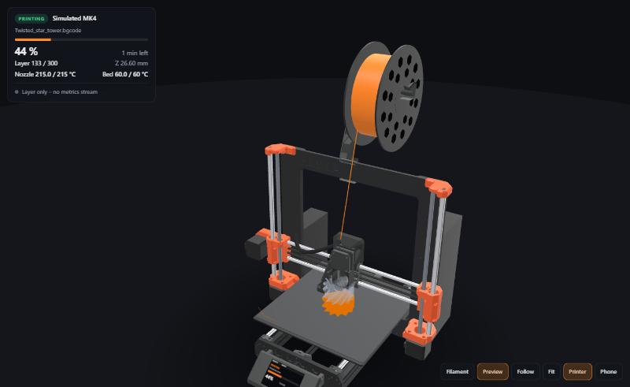
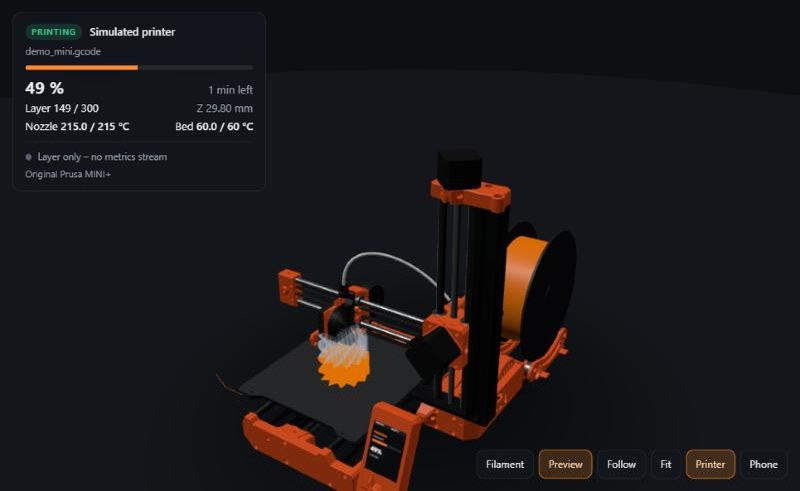
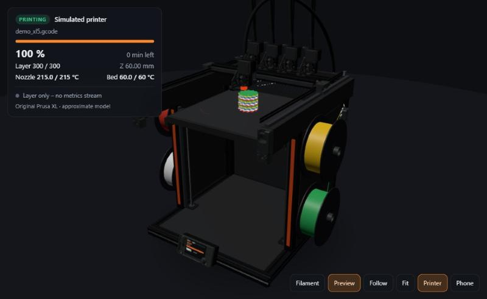
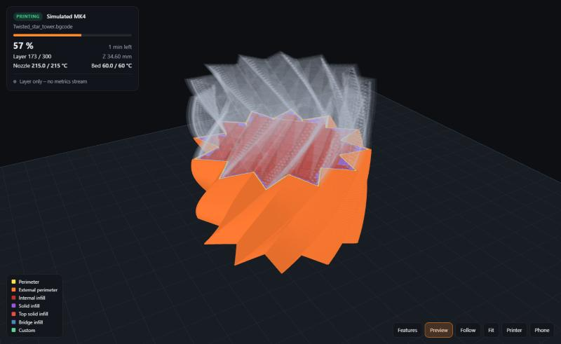

# PrintTwin – a live 3D digital twin of your 3D printer

**Watch your print grow in real time, in 3D.** PrintTwin follows your printer live and
draws the part in your browser exactly as the nozzle lays it down – on a true-to-size,
animated model of the printer whose bed, gantry and extruder move with the real machine.
A live G-code / bgcode viewer for Prusa printers via PrusaLink – MK4, MK4S, MINI+ and XL
in 3D, multi-material prints in their real colours. Works on PC, tablet and phone.



| Original Prusa MINI+ | Original Prusa XL – five heads, the idle ones docked |
|---|---|
|  |  |
| **Multi-material**: every tool's filament in its colour | Slicer feature colours + preview of what's still to print |
|  |  |

## Supported printers

PrintTwin started on the Original Prusa MK4 – **support for more printers is in the works**.

| Printer | Connection | Status |
|---|---|---|
| **Original Prusa MK4** | PrusaLink + firmware metrics | ✅ tested (firmware 8.0), true-to-size 3D model |
| **Original Prusa MK4S** | PrusaLink + firmware metrics | 🧪 should work today (same firmware) – **testers wanted**; true-to-size 3D model |
| Original Prusa MK3.9 / MK3.9S | PrusaLink + firmware metrics | 🧪 should work today – **testers wanted**; shown as the MK4 / MK4S (approximate) |
| Original Prusa MINI / MINI+ | PrusaLink + firmware metrics | 🧪 should work today – **testers wanted**; true-to-size 3D model |
| Original Prusa MK3 / MK3S / MK3S+ | PrusaLink on a Raspberry Pi | 🧪 new – tested against a simulated PrusaLink 0.7.2, **testers wanted**; position *estimated* from Z and progress (PrusaLink reports no nozzle position); SD-card jobs need the slicer hand-over or PrintTwin as print host; generic bed-slinger model until the MK3S+ model is done |
| Original Prusa XL | PrusaLink + firmware metrics | 🧪 should work today – **testers wanted**; 3D model with Prusa's parts, frame estimated (approximate) |
| Prusa CORE One / CORE One L | PrusaLink + firmware metrics | 🧪 should work today – **testers wanted**; generic CoreXY model until their own is done |
| **Klipper printers** (Voron 2.4 / Trident / V0, Sovol SV08, RatRig, Creality K1, Qidi, Elegoo, … – anything with Moonraker) | Moonraker | 🧪 new – tested against a simulated Moonraker, **testers wanted**; generic CoreXY (bed or flying gantry) or bed-slinger model |
| OctoPrint printers (Ender 3 …) | OctoPrint API | 📋 planned |
| **Bambu Lab** (X1, P1, P2S, X2D, A1, A1 mini, A2L, H2D/H2S/H2C) | MQTT + FTPS on the local network (read-only) | 🧪 new – tested against a simulated printer, **testers wanted**; position *estimated* from layer and progress (Bambu printers report no nozzle position); generic CoreXY / bed-slinger model |
| True-to-size models for the *Printer* view: MK3S+, CORE One, CORE One L; the XL refined | – | 📋 planned |

PrintTwin asks the printer which model it is (PrusaLink), so the *Printer* view picks the
right one by itself; `model = "mk4s"` in the config overrides it. Klipper doesn't know its
model: PrintTwin takes the printer name the slicer wrote into the job (PrusaSlicer `V2_350`,
OrcaSlicer `Voron 2.4 350`, `Creality K1 Max`, …) and else Klipper's kinematics – a quad
gantry level means a flying gantry (Voron 2.4, Sovol SV08).

Have one of these printers? A short test report helps a lot – see
[CONTRIBUTING.md](CONTRIBUTING.md#test-printtwin-with-your-printer). PrintTwin is an
independent project, not affiliated with Prusa Research.

## Features

* **Live, not a guess**: follows the printer's own nozzle position (Prusa ~80 Hz, Klipper
  ~4 Hz, the nozzle then moves along the toolpath in between) and file position, so the view
  matches the real print to the extrusion line.
* **The whole printer** (button *Printer*): a true-to-size MK4, MK4S or MINI+ built from
  Prusa's CAD parts, and an XL with up to five heads – the bed moves, the gantry and print
  head follow the nozzle, the spool unwinds, the display shows the live status, the MK4's
  heater glows with the nozzle temperature.
* **Multi-material**: jobs with several tools (XL) or filaments (MMU) are drawn in each
  filament's colour; the XL shows all its heads (up to five, from the printer model in the
  job) with a spool per head – three on the left side, two on the right – parks the idle
  heads in their docks and picks up the active one at every tool change.
* **Inside your slicer**: PrusaSlicer's *Physical Printer* tab and OrcaSlicer's *Device* tab
  show PrintTwin's live 3D view; uploads go through PrintTwin to the printer.
* **Fast**: the model appears seconds after a print starts – PrintTwin keeps a copy of every
  job the slicer sends, and otherwise the file is shown while it downloads.
* **Any slicer**: `.bgcode` and `.gcode` from PrusaSlicer, OrcaSlicer, Bambu Studio,
  SuperSlicer and Cura.
* **Phone & tablet**: the *Phone* button shows a QR code; anyone on your Wi-Fi can watch.
* **Nothing to install** but Python 3.11+: no packages, no cloud, no account.

## Quick start

1. Install **Python 3.11 or newer** – [python.org](https://www.python.org/downloads/)
   (Windows: tick *Add python.exe to PATH*). macOS/Linux usually have it already.
2. Get PrintTwin: *Code → Download ZIP* on GitHub (and unzip), or
   `git clone https://github.com/MrMechi001/PrintTwin.git`
3. Start it: Windows `PrintTwin.bat` (double-click), macOS/Linux `./start.sh`.
   The first start creates `config.local.toml` and stops.
4. Open `config.local.toml` in a text editor and enter your printer's **IP address** and
   **PrusaLink API key** (printer: *Settings → Network*, and *Settings → Network → PrusaLink*;
   MK3 / MK3S / MK3S+: see [below](#original-prusa-mk3--mk3s--mk3s-prusalink-on-a-raspberry-pi)).
5. Start PrintTwin again – the viewer opens at <http://localhost:8790/>.
   Windows asks once whether Python may use the network: allow it on **private networks**.

### Turn on the printer's metrics (for the live nozzle position)

Without this you still get the print layer by layer; with it you get the exact nozzle.
On the printer: **Settings → Network → Metrics & Log**

* *Metrics host* = the IP address of the computer running PrintTwin, *port* = `8514`,
  enable metrics;
* in the **Metrics List** switch on `pos_x`, `pos_y`, `pos_z` (`sdpos` is on by default).

The HUD shows what arrives: *Live nozzle position · 80 Hz* when everything is set.

### Original Prusa MK3 / MK3S / MK3S+ (PrusaLink on a Raspberry Pi)

The MK3 family talks to PrusaLink running on a Raspberry Pi (Prusa's Pi image, PrusaLink 0.7 / 0.8):

```toml
[[printer]]
id = "mk3s"
name = "Prusa MK3S+"
kind = "prusalink"
host = "192.168.1.50:8080"    # the Pi's address (PrusaLink listens on 8080; Prusa's Pi image also on 80)
api_key = "..."               # PrusaLink's web page: Settings -> API key ...
# user = "..."                # ... or the user name and password you chose in PrusaLink's setup
# password = "..."
```

* **Position estimated:** PrusaLink on the Pi reports no nozzle position (no metrics, no X/Y while
  printing) – only the height every 2 s, the percent and the time left. PrintTwin places the print
  between the job's progress marks, inside the layer the printer is at (a Z hop doesn't count as a
  layer), and moves it on with the time; the HUD says *estimated*. Stealth mode is recognised (its
  percent follows other marks in the G-code).
* **Jobs from the SD card** can't be downloaded from PrusaLink: use the slicer hand-over (below) or
  PrintTwin as the print host – then PrintTwin has the file. Jobs uploaded to the Pi (PrusaSlicer,
  Prusa Connect) are downloaded as usual. The MK3 prints plain `.gcode` (no `.bgcode`).
* **Model:** PrintTwin reads the printer type from PrusaLink (`PrusaLink I3MK3S` → MK3S / MK3S+, the
  same type code for both). The *Printer* view shows the generic bed-slinger until the true-to-size
  MK3S+ model is done.
* **Printer somewhere else** (workshop, another network): PrintTwin needs to reach the Pi's address –
  use a VPN such as Tailscale on the PC and the Pi and put the Pi's Tailscale address into `host`.
  Don't forward PrusaLink's port on your router.

### Klipper printers (Voron & co.)

A `[[printer]]` block with `kind = "moonraker"` (Moonraker comes with Mainsail and Fluidd):

```toml
[[printer]]
id = "voron"
name = "Voron 2.4"
kind = "moonraker"
host = "voron.local"          # Mainsail / Fluidd address (port 80), or "192.168.1.30:7125"
# api_key = "..."             # only if Moonraker asks for one (default: LAN clients are trusted)
```

PrintTwin reads Klipper's status, the file position and the live toolhead position (Klipper
updates it 4 times a second; in between the nozzle follows the toolpath) and loads the job
file from Moonraker. Klipper prints plain `.gcode` only. Nothing to set up on the printer.

### Bambu Lab printers

A `[[printer]]` block with `kind = "bambu"`:

```toml
[[printer]]
id = "p1s"
name = "Bambu Lab P1S"
kind = "bambu"
host = "192.168.1.40"         # the printer's IP address
serial = "01P00A..."          # printer screen: Settings -> Device (the serial number)
access_code = "12345678"      # printer screen: Settings -> Network / WLAN (LAN access code)
```

PrintTwin only **reads**: the status over MQTT and the job file over FTPS – no printer control,
no Bambu cloud, no Developer Mode needed. Bambu printers report the layer and the percent of the
print but **no nozzle position**, so the position in the 3D view is *estimated* between the
slicer's progress marks in the job (the HUD says so) – coarser than on a Prusa or Klipper printer.
The printer model comes from the serial number.

The job file: X1, P1 and A1 keep it where PrintTwin can download it. The H2D / H2S / H2C, P2S and
X2D print from internal storage, which is not reachable – turn on *Store sent files on external
storage* (print options) and insert a USB stick / SD card, or use the hand-over below (the viewer
says so when it can't find the file). An older file under the same name (an earlier version of the
job) is not taken while this print's may still show up, and a file whose layer count doesn't match
what the printer reports is dropped; printing the same job again starts over.
Before it sends the access code, PrintTwin checks the printer's certificate: signed by Bambu (Bambu's
CA certificates come with PrintTwin, from [ha-bambulab](https://github.com/greghesp/ha-bambulab),
MIT) and made out to your printer's serial number. A newer model whose certificate chain these
don't cover yet is checked by its fingerprint instead - remembered on first contact, refused if
it changes (the log says so; delete `cache/tls/<serial>-*.sha256` after replacing or resetting
such a printer). With `cafile = "..."` in the printer's block you can use a CA file of your own.

### Optional: PrintTwin inside PrusaSlicer / OrcaSlicer

Set PrintTwin as the slicer's print host: the printer tab of the slicer then shows the live
3D view, *Send to printer* / *Upload and print* go through PrintTwin to the printer, and
PrintTwin keeps a copy of the file, so the model is ready the moment the print starts.

1. In `config.local.toml`:
   ```toml
   [slicer]
   print_host = true
   ```
   and restart PrintTwin.
2. **PrusaSlicer**: printer combo box → *Add physical printer* (or the cog next to your
   printer). **OrcaSlicer**: the Wi-Fi/connection button next to the printer.
   * Host type: **PrusaLink**
   * Hostname / URL: `http://<IP of the PC running PrintTwin>:8790/p/<printer id>`,
     e.g. `http://192.168.1.20:8790/p/mk4` (the `id` from `config.local.toml`)
   * Authorization type **API key**: the printer's PrusaLink password / API key (printer:
     *Settings → Network → PrusaLink*; MK3 family: PrusaLink's web page, *Settings → API key*), then *Test*.
   * **Klipper printers**: host type **Klipper (via Moonraker)** (PrusaSlicer) or **Moonraker
     (Klipper)** (OrcaSlicer 2.4+) – *OctoPrint* / *Octo/Klipper* works too if Moonraker has
     `[octoprint_compat]`; API key only if your Moonraker wants one.
3. PrusaSlicer shows a tab with the printer's name, OrcaSlicer the *Device* tab – both now
   show PrintTwin.

PrintTwin passes every call on to the printer unchanged, with the key the slicer sends –
it adds no credentials of its own, so it can do nothing the slicer couldn't do on the
printer directly. Use the API key: user name/password (digest) logins only work with the
address without `/p/<printer id>` (`http://<PC>:8790`, one printer in the config).
Klipper: Moonraker usually trusts every device on the LAN by its address, so PrintTwin passes
on only the slicer's calls (connection test, upload, start the uploaded file) – no G-code,
no emergency stop, no file deletion, no reboot – and, without an API key, only from LAN
addresses. OrcaSlicer's experimental "printer agent" (off by default) is not supported.
OrcaSlicer only: to keep uploading straight to the printer and only show PrintTwin, leave
the printer as host and put the PrintTwin address into *Device UI* (`print_host_webui`).

### Optional: let the slicer hand over each job (model ready ~2 s after the start)

Not needed if PrintTwin is your print host (above) – for uploads via Prusa Connect or USB stick,
and for **Bambu Lab** printers (Bambu Studio and OrcaSlicer: *Process → Others → Post-processing
scripts*, same line as below): the job is then there even when the printer prints from internal
storage, and PrintTwin doesn't have to download it. Bambu Studio hands over every slice under a
temporary name, so PrintTwin takes the slice with the printer's layer count that was made in the
12 hours before the print started; when several different slices fit (two plates of the same
height), it tries the printer's own file first.

Downloading the job file from the printer over Wi-Fi is slow (~18 KB/s during a print).
PrusaSlicer runs post-processing scripts on the finished file – exactly the bytes it then
uploads (Prusa Connect, PrusaLink) or writes to the USB stick – so a tiny hook can give
PrintTwin a copy. In PrusaSlicer: *Print Settings → Output options → Post-processing
scripts*, one line with full paths, then save the print profile:

```
"C:\Path\To\python.exe" "C:\Path\To\PrintTwin\tools\prusaslicer_hook.py"
```

The hook only copies the file to `incoming/` (it never changes or blocks an export;
problems go to `logs/hook.log`). Without it PrintTwin still works – the model then builds
up while the file downloads.

## Security & privacy

* PrintTwin only **reads** from the printer (status, job file, metrics). It cannot start,
  stop or change anything on its own.
* As the slicer's print host (`[slicer] print_host = true`, off by default) it passes the
  slicer's calls on to the printer – with the key the slicer sends, never with its own. Without
  the printer's API key nobody can upload or print through it. Bambu printers are only read:
  PrintTwin only asks them for their status and firmware version. Klipper printers usually trust
  the whole LAN (Moonraker `trusted_clients`): there PrintTwin passes on only uploads and the
  start of an uploaded file, and only from LAN addresses unless the slicer sends Moonraker's
  API key.
* The API key (or PrusaLink user and password) stays in `config.local.toml` on your computer; the
  browser never sees it.
* The viewer has **no login**: anyone on your network can watch. Keep it there – don't
  forward the port on your router. For remote viewing use a VPN such as Tailscale.
* No cloud, no telemetry. Files stay in the PrintTwin folder (`cache/`, `incoming/`, `logs/`).
* Found a security problem? Please report it privately – see [SECURITY.md](SECURITY.md).

## How it works

```
 Slicer ──upload/USB──► printer        (or slicer ──► PrintTwin /p/<id> ──► printer, a copy kept)
                           │  PrusaLink HTTP: status, job, job file
                           │  UDP metrics:    sdpos 10 Hz, pos_x/y/z ~65-85 Hz
                           ▼
 PrintTwin bridge (Python, standard library only)
   printer.py   poll status every 2 s, detect jobs, get the job file (cache → slicer hand-over → download)
   bgcode.py    decode .bgcode (heatshrink + MeatPack) byte-exact like the firmware
   toolpath.py  G-code → extrusion segments in file order, incrementally (arcs, widths, feature types,
                tool / filament changes and colours)
   tracker.py   file position + nozzle xyz → "printed" = segment index + fraction
   server.py    HTTP + Server-Sent Events
   moonraker.py   Klipper printers: Moonraker status ~4 Hz (file position, live toolhead position)
   bambu.py       Bambu Lab printers: MQTT status ~1 Hz, job file over FTPS, position estimated (mqtt.py, ftps.py)
   slicerhost.py  print host for PrusaSlicer / OrcaSlicer: the slicer's calls passed through, uploads kept
                           ▼
 web/ (three.js)  one instanced draw call for all segments; a single uniform
                  (segment count) decides what is printed, so playback is free
```

Measured on an MK4 (firmware 8.0.0, PrusaSlicer 2.9.7):

* `sdpos` counts bytes of the **decoded** G-code stream, not of the .bgcode file; PrintTwin's
  decoder reproduces that stream exactly (every sdpos lands on a line start).
* `pos_x/y` is the real nozzle (median 0.011 mm from the G-code path); `pos_z` includes
  the mesh-bed-levelling offset; the nozzle runs 4–9 moves behind `sdpos` (planner buffer).
* Over Wi-Fi ~3 % of the metric datagrams are lost and they arrive in ~150 ms bursts;
  the viewer plays them back 450 ms delayed for smooth motion.

Fallbacks: file position only → fixed planner lag; no metrics → *estimated* from PrusaLink's
Z height (the layer), percent and time left, between the job's M73 progress marks (MK3 family on a
Raspberry Pi, Bambu Lab: always). Once metrics arrive the live position takes over. The HUD warns
("file position off") if the printer's file and PrintTwin's copy disagree.

### The MK4 and MK4S models

Prusa publishes the CAD of every printed part (STEP, GPL-2.0) but no complete MK4 or MK4S.
`tools/cad/build_mk4.py [mk4|mk4s]` builds `web/models/mk4.glb` / `mk4s.glb` from:

* **FokieH's MK4 assembly** ([Printables 961911](https://www.printables.com/model/961911), GPL-2.0)
  – its printed parts are verified against Prusa's official files (identical volumes);
* **Prusa's MK4 printable parts** ([Printables 451501](https://www.printables.com/model/451501), GPL-2.0)
  – each part is located in the assembly (< 0.01 mm); their NEMA17 hole patterns place
  the motors; the Nextruder main plate and idler are added;
* **Prusa's MK4S printable parts** ([Printables 451500](https://www.printables.com/model/451500), GPL-2.0)
  – the MK4S Nextruder: print-fan case and cover at the front, 360° fan shroud, fan-door
  cover, heatsink spacer; plus the MK4S LoveBoard cover and Y belt holders. Where these
  parts sit was found by registering each one on Marcus_3D's MK4S model
  ([Printables 1030417](https://www.printables.com/model/1030417), GPL-2.0) – within 1 mm
  everywhere; that mesh is only a reference, the model is built from Prusa's own files;
* parts generated from official dimensions: MK52 heatbed (254 × 264.4 mm), steel sheet
  (252 × 241 mm), spacers, bearings, belts, nozzle and heater block, fan rotors.

Calibrated to the G-code frame (X travel centred between the X-ends, sheet 10.4 mm above
the Y-carriage → the source model's nozzle sits exactly at the firmware's Z max of 221 mm).
Rebuilding needs CadQuery and the Printables downloads in `cad_src/`; using the models
needs nothing. `web/lab/model.html?f=../models/mk4s.glb&up=z` inspects one part by part.

### The MINI+ model

`tools/cad/build_mini.py` builds `web/models/mini.glb` from Prusa's
[Original-Prusa-MINI](https://github.com/prusa3d/Original-Prusa-MINI) repository (GPL-3.0):
every printed part, the heatsink, Y-carriage and steel sheet are Prusa's STEP files; the
30 × 30 extrusions, rods, motors and the hotend (heatbreak, heater block, nozzle) are
generated from Prusa's drawings in the same repository. Where the parts sit comes from
Luis's MINI assembly ([Printables 307054](https://www.printables.com/model/307054), public
domain), which uses Prusa's part frames exactly – a reference only, none of its geometry is
used. The SuperPINDA holder is placed by the firmware's probe offset (−29, −3 mm). The
firmware also fixes the G-code frame: X and Y home against hard stops (X 180.4 at the Z
carriage, Y −3 at the rear plate), and those stops were measured by sliding the parts along
their rods; at Z max 185 the carriage stops 2.5 mm under the top. The extruder rides on the
Z carriage, a 275 mm PTFE bowden runs to the hotend, and the spool stands on the printed
spool holder behind the column.

### The XL model (approximate)

`tools/cad/build_xl.py` builds `web/models/xl.glb` (CoreXY, one to five tools). There is no
published XL assembly, so it combines Prusa's
[XL printable parts](https://www.printables.com/model/449554) (GPL-2.0), the Nextruder of the
MK4 model, the firmware's geometry (360 × 360 × 370 mm, stops, tool docks at Y 455) and
PrusaSlicer's XL bed. The frame is measured on Prusa's dimension photo (front and side view,
perspective-corrected with the 365 mm sheet as scale): 504 mm wide base, top side beams
overhanging front and back, Z-axis posts with the LED strips 160 mm behind the base front,
the heads standing above the frame. The filament runs from the side spools back and up to
the entry sensors, then through the cable bundle that arcs over the frame onto the head.
The viewer marks the XL *approximate* until real measurements or Prusa's CAD refine it.

## Development

Contributions welcome – especially test reports from other printers and new printer
adapters: see [CONTRIBUTING.md](CONTRIBUTING.md).

* `python -I tests/test_toolpath.py` – parser: `.gcode` == `.bgcode`, other slicers,
  incremental decoding; `python -I tests/test_bridge.py` – end-to-end with a simulated printer;
  `tests/test_slicerhost.py` – the slicer print host; `tests/test_bambu.py` – Bambu Lab printers
  end to end; `tests/test_mqtt.py` – the MQTT client; `tests/test_moonraker.py` – Klipper
  printers end to end; `tests/test_mk3.py` – MK3 / MK3S+ with PrusaLink on a Raspberry Pi (digest
  login, SD-card jobs, the estimated position) and the MK4's live metrics; `tests/test_models.py` –
  printer detection; `tests/test_glb_models.py` – the 3D printer models.
* `python -I tools/sim_printer.py JOB.bgcode --kbps 18 [--handover] [--type 3.1.0]` – a fake
  PrusaLink printer plus the bridge on port 8791: try PrintTwin without a printer; `--type`
  picks the printer it pretends to be (PrusaLink type codes in `printtwin/models.py`, e.g.
  `1.4.1` MK4S, `2.1.0` MINI, `3.1.0` XL). It is also a print host for a slicer:
  `http://localhost:8791/p/sim`, host type PrusaLink, API key `sim` – *Upload and print*
  makes the upload the simulated job. `--pi` (or `--type 1.3.1`) makes it an MK3S+ with PrusaLink
  0.7.2 on a Raspberry Pi: `--stealth`, `--sd` (job on the SD card), `--digest USER:PASS` (digest
  login instead of the key), `--no-printer S` (503: printer not connected), `--dir D` (one folder per
  simulator).
* `python -I tools/sim_bambu.py JOB.gcode.3mf [--style p1|x1] [--internal] [--handover] [--pin]` – a
  simulated Bambu printer (TLS MQTT + FTPS, needs the openssl tool) plus the bridge on port 8796.
* `python -I tools/sim_moonraker.py JOB.gcode [--qgl] [--duration 120] [--api-key K] [--rewrite]`
  – the same for a Klipper printer: a simulated Moonraker (port 7125) plus the bridge on
  port 8793; print host `http://localhost:8793/p/sim`, host type Klipper (via Moonraker).
* `tools/cad/build_mk4.py`, `build_mini.py`, `build_xl.py` – rebuild the 3D printer models
  (needs CadQuery and the CAD downloads named in each script).
* `tools/probe_api.py`, `tools/probe_metrics.py` – inspect a real printer
  (metrics recordings contain the printer's MAC address – don't publish them).
* `tools/make_fixtures.py` – regenerate the test jobs with PrusaSlicer.

## Roadmap

**More printers** (see [Supported printers](#supported-printers))
* An OctoPrint adapter next to PrusaLink, Moonraker (Klipper) and Bambu Lab.
* Bambu Lab: a "PrintTwin for OrcaSlicer" plugin (a PrintTwin tab + the hand-over without a
  script), the estimate calibrated on a real printer.
* True-to-size models for the *Printer* view: Bambu Lab printers next, then CORE One and
  CORE One L (MK4, MK4S and MINI+ are done, the XL is approximate) and the Voron 2.4 and Trident
  from the Voron CAD (GPL-3.0); generic bed-slinger / CoreXY / flying-gantry models for
  everything else.

**Inside your slicer** (✅ PrusaLink and Klipper printers, see [above](#optional-printtwin-inside-prusaslicer--orcaslicer))
* Next: a compact view for the slicer tab.

**Control the printer from the 3D view** (opt-in, behind a login)
* Start, pause and stop prints, upload jobs and manage a print queue right where you watch
  the print. Today PrintTwin is deliberately read-only; control features will only come
  with authentication, so nobody else on your network can operate the printer.

**Easier to run**
* Setup page in the browser (no config file editing), Windows package with tray icon.
* Always-on: Docker / Home Assistant add-on / Raspberry Pi.
* Bundle three.js for offline use (now loaded from jsDelivr).

## Licence

PrintTwin is free software under the **GNU GPL v3** (`LICENSE`). The printer models
`web/models/mk4.glb` and `mk4s.glb` are GPL-2.0 derivatives of FokieH's and Prusa Research's work,
`mini.glb` is a GPL-3.0 derivative of Prusa Research's MINI files, `xl.glb` a GPL-2.0 derivative of
Prusa's XL parts – see `web/models/NOTICE.md`. Uses [three.js](https://threejs.org) (MIT) and
[qrcode-generator](https://github.com/kazuhikoarase/qrcode-generator) (MIT).
"Prusa" and "Original Prusa" are trademarks of Prusa Research a.s.; PrintTwin is an
independent project.
